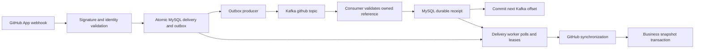

# GitHub Kafka flow verification — TASK 06 / DO-402 / SCRUM-202

Verification date: 2026-10-12. Working branch: `integration/main-kafka-production-20261011`.
Base commit: `1810f09535d6a6d00947bcf84d18fde473e40c39`, with local changes from TASK 02–05 preserved.
This report covers source inspection and disposable local tests. Production provider acceptance
requires separate authorization; no live webhook, deployment, credential or infrastructure change
was performed for this task.

## Flow and acknowledgement boundaries

The implementation follows the previously approved [same-service contract](azure-production/KAFKA_CONTRACT_PROPOSAL.md).
It does **not** enforce business synchronization before a Kafka offset commit. Kafka commits after
an immutable reference is validated and its durable receipt commits to MySQL. The existing delivery
worker independently polls/leases MySQL deliveries and completes synchronization, including while
Kafka is unavailable. Ingress and Kafka handoff both signal that worker.



Business processing can precede publication or consumption; handoff and offset success are not
proof of a completed provider sync. Polling fallback and this distinction are intentional approved
behavior, not changed in this task. A mandatory Kafka-only sequence or offset-after-business-sync
policy would require a separately reviewed design change.

## Implementation and verification matrix

Paths below are relative to the repository root.

| Requirement | Implementation location / evidence | Verified behavior and limits |
|---|---|---|
| Webhook endpoint and signature | `src/Services/ResearchTrack.GitHubService/Controllers/GitHubWebhooksController.cs`; `Features/Webhooks/GitHubWebhookSignatureVerifier.cs` under that service | Anonymous `POST /api/v1/github/webhooks` and `/api/github/webhooks`; JSON; accepted/duplicate delivery returns **202**. HMAC-SHA256 over original bytes, 32-byte digest, constant-time comparison. Invalid signature returns 401 before persistence. Gateway preserves both route prefixes. |
| Identity and payload validation | `Features/Webhooks/GitHubWebhookIngressService.cs`; signature/ingress unit tests | Delivery ID required, trimmed, at most 128 characters; event required, lowercase, at most 64 ASCII letters/digits/underscore/hyphen. Advertised length and streamed bytes bounded. JSON object required; wrongly typed ID rejected with 400 after this task's fix. Missing installation remains eligible for the existing non-Kafka handling path. |
| Atomic acceptance | `Features/Webhooks/GitHubWebhookDeliveryStore.cs`; `KafkaMessagingTests.SignedIngressCreatesAtomicOutboxAndDuplicatesReuseIdentity`, `FailedOutboxInsertRollsBackAcceptedInbox` | One relational `SaveChanges` persists delivery + outbox; an outbox insert failure rolls back both. Supported events with positive installation ID create an outbox only when Kafka enabled. Ping, unsupported and unmapped events keep the existing processing path. |
| Stable identity and deduplication | Same store; `Persistence/Configurations/GitHubWebhookDeliveryConfiguration.cs`; `Features/GitHubKafkaEventHandler.cs` | Unique provider DeliveryId; same payload/event returns original delivery/event and outbox identity. Changed payload/event under that ID produces 409. Consumer requires owned immutable outbox payload/key and matching delivery identity; durable EventId receipt and payload hash protect replay across handler instances. |
| Producer guarantees and retries | `src/BuildingBlocks/Kafka/KafkaClients.cs`, `KafkaPersistence.cs`, `KafkaMessagingWorkers.cs`; messaging/metrics tests | `acks=all`, producer idempotence, persisted acknowledgement required before PUBLISHED bookkeeping. 30s send timeout, bounded queue. Durable lease and retry schedule: 30s, 2m, 10m, 30m, then 1h; maximum 10 attempts. Retryable failures keep PENDING; permanent/exhausted work remains FAILED, blocking later unpublished messages with the same installation key. No automatic destructive repair/replay. |
| Topic and envelope | `deploy/azure/vm/kafka/topics.json`; `src/BuildingBlocks/Kafka/KafkaWebhookContract.cs` | `researchtrack.github.events.v1`, `github.webhook.ready`, string version `1`, key `installation:<id>`, one partition, RF1, retention 72h. Strict bounded JSON; duplicate/unknown fields, wrong version/key/domain rejected. EventId/CorrelationId/DeliveryRecordId share the stable delivery GUID. No raw provider payload/signing secret/token in Kafka. |
| Consumer configuration | `src/BuildingBlocks/Kafka/KafkaClients.cs`, `KafkaRuntimeOptions.cs`; options/messaging tests | Group `researchtrack-github-webhook-v1`; auto commit/store disabled; earliest applies only without a committed group offset; no automatic topic creation. TLS, public CA and endpoint identity verification preserved; production requires private IPv4:9092 and validated public CA. |
| Durable receipt/handoff | `Features/GitHubKafkaEventHandler.cs`; messaging/flow tests | Serializable transaction validates immutable ownership and delivery metadata, records receipt and commits, then signals existing worker. Existing FAILED/PROCESSING/processed state and retry/lease are preserved. Removed/already processed deliveries are recorded no-ops rather than re-enqueued. |
| Business result | `Features/Webhooks/GitHubWebhookDeliveryWorker.cs`, `GitHubWebhookEventProcessor.cs`, `Features/Synchronization/GitHubRepositorySynchronizationService.cs`; `GitHubKafkaFlowTests` | Default-branch pushes for active/enabled linked repositories use actual worker, event processor and synchronization service. Snapshot transaction upserts commits/branches/contributors/PRs/reviews, sets sync run SUCCESS, head SHA, revision and sync time. Local fixture stubs GitHub API clients, not business persistence. |
| Offset policy | `KafkaConsumerWorker.HandleAndCommitAsync`; `CommitFollowsSuccessfulHandlerAndNeverFollowsInvalidOrFailedProcessing`; isolated commit-recovery scenario | Commit follows successful receipt/handoff. Invalid/exhausted processing never commits. Commit failure closes/rejoins from broker offsets; replay deduplicates the existing receipt, then commits exactly the next offset. Business worker completion is an independent boundary. |
| Outage and exhaustion | `KafkaMessagingHealth`, outbox/consumer workers; existing isolated recovery fixture and exhaustion unit test | Pending deliveries/outbox survive broker failure; publication attempts bounded; existing clients reconnect. Processing retries three times, 15s budget per cooperative handler attempt, delays 1s/2s; failure/invalid record holds consumer without advancing offsets until review and service restart. Transient offset commit failure instead rejoins automatically. |
| HTTP/readiness and metrics | `Program.cs`; `src/BuildingBlocks/ResearchTrack.BuildingBlocks.Api/Extensions/ApplicationBuilderExtensions.cs`; `KafkaMetrics.cs`; `Features/Webhooks/GitHubWebhookMetrics.cs` | Liveness excludes dependency checks. Readiness includes MySQL and messaging state: Healthy when no recorded failure (not a broker probe), Degraded for publisher/persisted failed outbox, Unhealthy for held consumer. HTTP 200 also represents Degraded; read the body. Separate transport, receipt, commit and business counters must be observed. |

GitHub events eligible for Kafka: `push`, `pull_request`, `pull_request_review`,
`pull_request_review_comment`, `repository`, `installation`, `installation_repositories`.
No schema, topic, consumer group, retry settings, persistence or production enablement was changed.

## Confirmed correction and regression coverage

A correctly signed array/scalar/null root, or string/boolean nested ID, previously caused
`JsonElement.TryGetProperty` / `TryGetInt64` to throw `InvalidOperationException`, bypassing the
controlled 400 rejection. The new theory reproduced **7 failures / 1 pass** before the correction.
The existing syntactically invalid JSON case already returned 400.

`GitHubWebhookIngressService` now validates an object root and numeric nested IDs explicitly,
mapping invalid shapes through the existing invalid-JSON ApiException/metric path before the store
is called. Missing optional IDs still follow the existing path. Eight regression cases cover arrays,
string/number/boolean/null roots, string installation ID, boolean repository ID and incomplete JSON.
The eight cases pass in the final GitHub regression suite.

The existing isolated HTTP assertion now includes status code/reason in its failure diagnostic.
The required 200 assertion and health-state requirements remain intact.

## Executed results and evidence

Local host: macOS arm64, .NET SDK 10.0.400, Docker Desktop engine 29.2.1.
Ignored evidence: `artifacts/github-kafka-flow-verification/`; isolated evidence is also under
`artifacts/kafka-integration/<unique-project>/`. Retain TRX and logs with the reviewed source diff.

| Execution | Actual result |
|---|---|
| Initial GitHub regression filter `Category!=KafkaIntegration` | **FAIL**: 281 passed, 1 failed, 0 skipped. DatabaseIntegration readiness test lacked `RESEARCHTRACK_TEST_GITHUB_CONNECTION`; no production connection was substituted. |
| New ingress theory before fix | **FAIL**: 7 failed, 1 passed; `ingress-before-fix.trx`. An earlier discovery attempt matched zero tests and is not counted as a pass. |
| Final GitHub regression filter `Category!=KafkaIntegration&Category!=DatabaseIntegration` | **PASS**: 289 executed/passed, 0 failed, 0 skipped; `github-regression-final.trx`. DatabaseIntegration is explicitly excluded, not reported passed. |
| Kafka unit subsets within those 289 | **PASS**: messaging 15, metrics 9, runtime options 17, regular Kafka flow 3. |
| Webhook subsets within those 289 | **PASS**: ingress 10 (including 8 new cases), signature 6, event-processor coverage 19. |
| First disposable real-Kafka run | **FAIL**: GitHub 2 passed / 1 failed / 0 skipped; liveness assertion failed before outage verification. Jira not reached. Evidence project `rt-kafka-fixture-db64cffe7050`; data retained. |
| Fresh isolated Kafka suite after correction | **PASS**: GitHub 3/3 (4m18s), Jira 2/2 (2m45s), all five executed, zero skipped; runner exit 0. Project `rt-kafka-fixture-b21ed1460776`. |
| Runner final exporter/broker/topic/group checks | **PASS**: healthy exporter/broker state; topic and group snapshots retained. GitHub partition 0 committed offset 130, log end 130, lag 0; topic 1 partition/RF1/retention.ms=259200000. No active group members after workers close is expected. |
| Full solution Release build in isolated runner | **PASS**: 0 warnings, 0 errors on both completed build phases. |
| `./scripts/test-kafka-observability.sh` | **PASS**: 159 configuration assertions/checks, 30 Prometheus scenarios, 55 dashboard expressions parsed. |
| `./deploy/azure/validation/test-kafka-operations.sh` | **PASS**: 62 mocked operational assertions and 8 broker-control safety tests. No production broker contacted. |
| `bash -n scripts/test-kafka-integration.sh scripts/test-kafka-observability.sh`; `git diff --check` | **PASS**: both scripts parse; local diff whitespace check passed. |
| Real GitHub provider production acceptance | **NOT EXECUTED**: requires separate approval and verified live configuration. |

The separate DatabaseIntegration readiness case was not rerun: its protected harness requires a
`researchtrack_test_*` database and its own configuration; the Kafka fixture uses
`researchtrack_kafka_github`. That guard was preserved. The real-Kafka suite nevertheless exercised
the actual HTTP readiness endpoint with its disposable MySQL dependency, including outage/recovery.
No test of any other service's full regression suite is claimed; the runner built the full solution
and executed the specified GitHub/Jira Kafka integration suites only.

Existing real-Kafka tests reused rather than duplicated:

- `TlsBrokerOutageDurableRetryCommitRecoveryAndActualBusinessOutcome`: signed ingress, real MySQL,
  TLS producer/consumer, outage, unchanged identity/topics/offsets, scheduled retry, failure after
  receipt before commit, automatic replay/rejoin, actual sync snapshot, duplicate protection, HTTP
  availability, scraped metrics and held/lag alert transitions. Shared fixture lives in
  `tests/Kafka/IsolatedKafkaFixture.cs`. Fixture alert holds are shortened, not production thresholds.
- `RealProducerTimeoutRetainsDurableWebhookAndOutbox`: actual producer timeout against unavailable
  loopback port; pending row/delivery retained and retryable failure metric present.
- `HistoricalSchemaUpgradePreservesRepositoryRecordsAndAddsKafkaPersistence`: real disposable
  MySQL historical-schema upgrade and Kafka table/index checks, preserving repository data.
- Regular relational flow verifies actual worker + snapshot with mocked GitHub API and durable
  deduplication; rollback/exhaustion/lease/commit policy tests remain in the existing suites.

Fresh GitHub evidence (`rt-kafka-fixture-b21ed1460776`):

| Evidence | Observed result |
|---|---|
| `github-outbox-pending.json` → `github-outbox-published.json` | Same EventId `33a713f7-d0ea-4bcb-9942-127fb8d32637`: PENDING, attempt 1, `Local_MsgTimedOut` → PUBLISHED, attempt 2, error cleared; production retry timing retained. |
| `github-offset-recovered.json` | Approved topic/group, committed next offset 1 after receipt replay; handler called twice. |
| `github-business.json` | Head `aaaaaaaaaaaaaaaaaaaaaaaaaaaaaaaaaaaaaaaa`; 1 commit, 1 sync run, 1 durable receipt. |
| HTTP healthy/degraded JSON | Liveness, readiness and Swagger each 200; readiness body Degraded during outage and Healthy after recovery. |
| Held/recovered metric evidence | 128 replay records counted duplicate, 128 commits, held=0, outbox pending=0/failed=0; unchanged single sync/receipt. Test checked group lag=0 and held/lag firing alerts absent. |
| Outage/recovered alert JSON | ExporterUnavailable firing during outage and absent after recovery. ProcessingFailures remains in the rate window after held recovery; not falsely reported resolved. Other fixture ServiceUnavailable alerts can include a service whose test has not started. |

All identities and provider business data above are synthetic fixture values. These observations
establish local recovery behavior, not production acceptance or complete production alert recovery.
On runner exit, all five containers in its unique project were stopped; Kafka/MySQL data and volumes
were retained. Existing unrelated Docker projects were not stopped or modified.

## Reproduce safely on macOS with Docker Desktop

1. Start Docker Desktop with a local Unix-socket context; install the SDK required by `global.json`,
   Python 3 and OpenSSL. Confirm `docker info`, `dotnet --version`, `openssl version`, `python3 --version`.
2. In this worktree, ensure loopback ports 19092, 13307 and 19090 are free. The runner rejects a remote
   Docker endpoint and occupied ports; do not stop unrelated workloads to clear them automatically.
3. Run the existing fixture **alone**, without concurrent .NET builds that replace its loaded assemblies:

   ```bash
   ./scripts/test-kafka-integration.sh
   ```

   It creates a unique disposable project, generated test CA/localhost certificate, private fixture
   MySQL credentials, Kafka topics and monitoring. All application clients use localhost:19092 and
   localhost:13307. Only the labelled disposable broker can be stopped/restarted by its guarded control
   script. Expected result is GitHub **3/3**, Jira **2/2**, zero skips, successful exporter/topic/group checks.
   The runner restores/builds Release and checks TRX counts. On exit it stops only its project and retains
   test data/volumes; never use global pruning or `down -v` as a recovery step.
4. Run the database-independent GitHub regression suite and observability validation:

   ```bash
   env -u RT_KAFKA_TEST_ENABLE dotnet test \
     tests/ResearchTrack.GitHubService.Tests/ResearchTrack.GitHubService.Tests.csproj \
     -c Release --filter 'Category!=KafkaIntegration&Category!=DatabaseIntegration'
   ./scripts/test-kafka-observability.sh
   ```

5. Retain evidence from the printed unique project and fixture path: TRX, business JSON, outbox/offset/
   identity snapshots, HTTP statuses, metric and alert snapshots. Do not publish fixture env files,
   passwords or private TLS material. A manually run CategoryKafkaIntegration suite without the runner
   can skip; skipped cases do not establish integration acceptance.

## Production acceptance procedure — separate authorization required

No steps in this section were run. Obtain approval naming the GitHub App, legitimate test repository,
ResearchTrack project/repository link, exact commit action, deployment SHA, observation window and
optional redelivery. Avoid repositories that trigger this backend's production workflows. Using a
repository webhook without a GitHub App installation is insufficient: this Kafka route needs the
payload's positive installation ID. [GitHub's payload reference](https://docs.github.com/en/webhooks/webhook-events-and-payloads)
documents when the installation property is included.

### Preflight and baselines

1. Verify the already deployed image includes this flow, current database migrations and enabled Kafka
   configuration. Do not enable Kafka, edit app/webhook settings or change credentials as part of an
   unapproved test. Confirm the approved GitHub topic/group, public CA, private connectivity and fresh
   exporter/application samples. Configuration names/boolean state may be recorded; secret values must not.
2. Confirm DNS/TLS for the existing GitHub App callback `https://<approved-api-host>/api/v1/github/webhooks`
   (or configured `/api/github/webhooks`), JSON delivery, valid signing secret and subscribed push event.
   Confirm contents/PR read permissions and a connected, active, enabled link to the test repository's
   current **default branch**. A ping, tag push, non-default branch or unlinked repo cannot prove business sync.
3. Record UTC window, current branch head, link revision/sync status, topic log end and group offset/lag;
   capture fresh monitoring samples. Existing read-only VM checks (not smoke/restart):

   ```bash
   sudo /opt/researchtrack/scripts/verify-kafka.sh --check
   sudo /opt/researchtrack/scripts/kafka-topics.sh reconcile --check
   sudo /opt/researchtrack/scripts/kafka-topics.sh describe researchtrack.github.events.v1
   sudo timeout 60 /opt/researchtrack/scripts/compose.sh exec -T \
     -e KAFKA_HEAP_OPTS=-Xmx256m kafka /opt/kafka/bin/kafka-consumer-groups.sh \
     --bootstrap-server localhost:29092 --describe --group researchtrack-github-webhook-v1
   ```

   These inspect existing state. Do not create topics, join the application consumer group, reset offsets,
   restart the broker or invoke `--smoke` / `--restart` to make a test pass.

### Approved provider action and observations

4. After approval, use the normal GitHub workflow to make **one harmless documentation commit** with a
   unique marker such as `DO-402 acceptance <UTC>` on the approved test repo's default branch. If protected,
   use an approved PR and merge method; record the final resulting SHA and distinguish any additional PR
   deliveries from the push delivery. Do not bypass branch protection or push to ResearchTrack source.
5. In the GitHub App's recent webhook deliveries, locate that real `push` delivery; retain its delivery ID,
   event type, repository/installation IDs (redacted as needed), UTC time and callback response **202**.
   A provider request uses `X-GitHub-Delivery`, `X-GitHub-Event`, `X-Hub-Signature-256`; never attach its
   signature or full payload. Signature verification follows
   [GitHub's documented HMAC-SHA256 approach](https://docs.github.com/en/webhooks/using-webhooks/validating-webhook-deliveries).
6. Observe the event's stable EventId/key/version from its database outbox and correlate safe application
   acknowledgement/commit logs. Topic end offset should advance and the group should commit past that record;
   lag should settle to zero when the group is otherwise idle. A crash/retry can yield multiple records for
   one EventId. Total offsets/counters are shared with other deliveries: they alone cannot identify this event.
   Do not read arbitrary production payloads or start a new consumer using the application's group.
7. Using an existing approved **read-only** GitHub database session, query only selected evidence fields.
   Replace placeholders with the reviewed delivery ID, EventId, link GUID and final SHA; do not print a
   connection string or use password arguments. EF column names are case-sensitive as configured below:

   ```sql
   SELECT Id, DeliveryId, EventType, Status, AttemptCount, ReceivedAt, ProcessedAt, NextAttemptAt
     FROM github_webhook_deliveries WHERE DeliveryId = '<provider-delivery-id>';
   SELECT EventId, Topic, MessageKey, Status, AttemptCount, PublishedAtUtc, LastErrorCode
     FROM kafka_outbox_messages WHERE EventId = '<delivery-record-guid>';
   SELECT EventId, Outcome, HandedOffAtUtc
     FROM kafka_inbox_receipts WHERE EventId = '<delivery-record-guid>';
   SELECT Id, LastKnownHeadSha, SyncStatus, SyncRevision, LastSyncedAt
     FROM project_repository_links WHERE Id = '<approved-link-guid>';
   SELECT Sha, CommittedAt FROM github_commits
     WHERE RepositoryLinkId = '<approved-link-guid>' AND Sha = '<approved-final-sha>';
   SELECT Status, Trigger, StartedAt, CompletedAt, CommitsFetched
     FROM github_sync_runs WHERE RepositoryLinkId = '<approved-link-guid>'
       AND StartedAt >= '<acceptance-start-utc>' ORDER BY StartedAt DESC LIMIT 10;
   ```

   Expected: one delivery/event/outbox/receipt identity; outbox PUBLISHED; delivery PROCESSED; commit
   exists once per link/SHA; link sync SUCCESS, advanced revision and observed head equals the approved
   SHA if no later push occurred. Sync run SUCCESS with business fields persisted. Receipt may report
   `already_processed` if fallback ran first; that is acceptable, but does not itself prove business success.
   Sync runs have no delivery foreign key: correlate link/time/logs and keep other activity quiet rather
   than claiming a direct SQL join proves causality.
8. Inspect fresh `service="github"` samples in Prometheus/Grafana: enabled=1; publish success; consume
   process success/**noop**; commit success; outbox pending/failed; sample success/timestamp; held=0; group
   lag. Also inspect `researchtrack_github_webhooks_received_total`,
   `researchtrack_github_webhooks_processed_total{event="push",status="processed"}` and
   `github_sync_runs_total{trigger="WEBHOOK",outcome="completed"}`. Counter deltas may include other
   traffic; distinguish business counters from Kafka handoff counters. No failures should be induced live.
   Historical rate-window alerts may remain firing after a healthy recovery; assess timestamps/thresholds.
9. Only if redelivery was explicitly approved, choose **Redeliver** for that same GitHub App delivery.
   [GitHub documents that redelivery retains X-GitHub-Delivery](https://docs.github.com/en/webhooks/using-webhooks/best-practices-for-using-webhooks).
   Expect 202 with Duplicate=true and unchanged delivery/outbox/receipt identity, no additional sync
   attributable to that delivery. HTTP redelivery does not necessarily publish another Kafka record or
   increment consumer-duplicate metrics; consumer replay protection is separately proved locally.

### Evidence, failure handling and cleanup

Retain source/image SHA, UTC times, provider delivery ID, final repository head, selected sanitized SQL
rows, topic/group snapshots, bounded safe logs, fresh metrics/alert screenshots and reviewer sign-off.
Exclude signatures, App private keys, tokens, database passwords, full payloads and runtime env files.
Do not mark acceptance passed from a 202, a Kafka receipt, a zero lag sample or HTTP 200 alone.

If signature/identity fails, capture status/rejection reason without exposing a secret. If outbox remains
PENDING/FAILED or consumer held, use [Kafka operations](azure-production/KAFKA_OPERATIONS.md) and the
existing recovery procedure; do not reset offsets, delete rows or alter topics. A PROCESSED delivery with
an old business head needs sync/link/provider diagnostics; receipt success is insufficient. Stop sending
additional events when the agreed observation deadline expires and record missing evidence.

Leave audit deliveries/outboxes/receipts/commits intact. A documentation revert creates another provider
event and requires inclusion in the approved cleanup scope; do not automatically unlink/delete the test
repository, databases or topics. Any rollback uses the existing separately authorized deployment rollback
process, preserving forward-compatible migrations and pending work.

## Missing proof and acceptance checklist

- [x] Signature, identity, atomic persistence, retry/exhaustion, receipt/dedup, client/TLS and offset policy
  inspected and exercised by the executed GitHub unit/relational suite.
- [x] Confirmed ingress defect reproduced and locally corrected with eight regression cases.
- [x] Static observability and alert scenarios executed successfully.
- [x] GitHub real TLS Kafka/MySQL recovery results recorded (3/3, zero skips).
- [x] Shared runner's Jira and final topic/exporter postflight passed and recorded.
- [ ] Real HTTP webhook acceptance through deployed Gateway and Azure private Kafka path verified.
- [ ] Real GitHub App permissions/token/provider calls produce the approved default-branch business SHA.
- [ ] Production topic, group offsets, durable receipt, business rows and fresh metrics correlate to one
  approved provider activity and optional authorized redelivery.
- [ ] Redacted evidence, cleanup scope and owner acceptance retained.

RF1 remains a single broker with no redundancy. Local mocked GitHub APIs do not prove live provider
permissions, rate limits, DNS/TLS, Azure routing or deployed runtime configuration. Retained outboxes and
receipts need the already documented reviewed retention/replay policy. Duplicate handoff protection is
not a universal exactly-once guarantee for remote API calls across a crash during business processing.
The signed fixture invokes the ingress service directly; it does not POST through a deployed Gateway.
HTTP availability uses the real service pipeline/MySQL with fixture-controlled messaging health and
independently driven actual Kafka workers, avoiding duplicate host schedulers. Live controller/routing
and provider acceptance remain separate missing evidence. The initial liveness failure's cause is not
established; improved diagnostics and a fresh run do not by themselves prove its cause was repaired.

## Files changed by TASK 06

- `src/Services/ResearchTrack.GitHubService/Features/Webhooks/GitHubWebhookIngressService.cs`:
  reject malformed root/ID types through controlled validation.
- `tests/ResearchTrack.GitHubService.Tests/Features/Webhooks/GitHubWebhookIngressServiceTests.cs`:
  eight signed-payload regression cases, all checking 400 and no store call.
- `tests/Kafka/IsolatedKafkaFixture.cs`: include actual HTTP status in existing failure diagnostic.
- `docs/devops/GITHUB_KAFKA_FLOW_VERIFICATION.md`: implementation evidence, results and acceptance plan.

Other existing dirty files belong to prior tasks. No changes were committed, staged, pushed, merged or
deployed. Review/revert only this task's hunks if needed; preserve prior work and persistent state.
