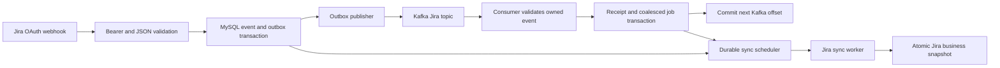

# Jira Kafka acceptance report — TASK 07 / DO-402 / SCRUM-202

Verified locally on 2026-10-12, branch `integration/main-kafka-production-20261011`, base commit
`1810f09535d6a6d00947bcf84d18fde473e40c39`. Existing TASK 02–06 work is preserved. This report separates
executed local evidence from the authorization-dependent production acceptance procedure.

## Processing and acknowledgement boundaries

The [approved contract](azure-production/KAFKA_CONTRACT_PROPOSAL.md) carries references to already
accepted Jira events. The webhook persists its event/outbox atomically, then requests a durable sync
job directly. The Kafka consumer validates ownership, stores a receipt and coalesces a durable job
in one transaction. Offsets commit **after this durable handoff**, not after Jira business sync.
`JiraSyncWorker` independently processes the durable job; reconciliation remains available without Kafka.



Thus a webhook can schedule or finish business work before Kafka publication/consumption. A receipt,
successful commit or zero group lag does not establish completed business sync. Making business
completion a prerequisite to committing Kafka offsets would change the approved design; this task
preserves its existing fallback and acknowledgement policy.

## Implementation verification matrix

Service-relative paths below start at `src/Services/ResearchTrack.JiraService/`.

| Requirement | Location | Verified behavior / evidence |
|---|---|---|
| 1. Webhook validation | `Controllers/JiraWebhookController.cs`; `Features/JiraWebhookService.cs`; webhook test suites | Anonymous **POST `/api/v1/jira/webhooks`**, 2 MiB request limit. OAuth bearer JWT, HS256 with app client secret and constant-time signature comparison; exp type/range checked when present with existing 1m allowance. Unauthorized returns 401; authenticated accepted/unmatched deliveries return **200**. Malformed JSON/non-object root now returns controlled 400 before persistence/scheduling. |
| 2. CloudId identity | `JiraWebhookService.ReceiveAsync`; `Features/JiraKafkaEventHandler.cs` | CloudId comes from the selected persisted connection, not an arbitrary request field. Known matched webhook IDs determine connections and restrict expansion to their clouds. Without a matched ID, project fallback is used only if one cloud matches. Invalid-auth connections excluded. Consumer requires record/envelope CloudId equality and the currently connected cloud before scheduling. |
| 3. Project identity | Same service/handler; `Persistence/JiraDbContext.cs` | ResearchTrack GUID differs from Jira's project ID/key. Routing uses known webhook registration, then project fields/key fallback. Outbox key is the ResearchTrack project GUID in canonical D format. Consumer requires that GUID to match the owned event and connection; empty GUID/wrong key rejected. Known webhook registration takes precedence over conflicting payload project fields, preserving existing tested behavior. |
| 4. Event type | `src/BuildingBlocks/Kafka/KafkaWebhookContract.cs`; `JiraWebhookService.AddKafkaOutbox` | Only exact `jira:issue_created`, `jira:issue_updated`, `jira:issue_deleted` create Kafka events. Other accepted provider event names retain existing scheduling behavior. Contract requires `jira.webhook.ready`, string version `1`, matching EventId/WebhookRecordId/CorrelationId, and strict fields/version/key. |
| 5. Exact timestamps | `JiraKafkaEventHandler`; `JiraDbContext`; shared contract; precision tests | OccurredAtUtc is the local durable ReceivedAt, not the provider's issue-update timestamp. Existing UTC/write precision policy and datetime(6) mappings preserved. Ownership checks exact ReceivedAt equality in SQL. Running-job coverage now compares persisted StartedAt and ReceivedAt in SQL too. No new rounding/tolerance or weaker contract comparison. One-microsecond boundary regressions and real-MySQL negative SQL checks protect this. |
| 6. Atomic event/outbox | `JiraWebhookService.ReceiveAsync`; `KafkaMessagingTests.OutboxFailureRollsBackJiraWebhookAcceptance` | New/promoted matched event + immutable outbox + connection webhook metadata saved together by one relational SaveChanges. Scheduling is subsequent; failed scheduling leaves durable RECEIVED work/outbox for retry/consumer handoff. Injected outbox insert failure rolls both event/outbox back. |
| 7. Kafka publication | `src/BuildingBlocks/Kafka/KafkaClients.cs`, `KafkaPersistence.cs`, `KafkaMessagingWorkers.cs`; real fixture | SSL/public CA/endpoint verification; idempotent producer, acks=all, persisted acknowledgement before PUBLISHED bookkeeping; bounded queue and 30s send timeout. Outbox retains work on failure. Real fixture tests outage, original producer reconnect and scheduled retry. |
| 8. Kafka consumption | Same shared clients/workers; `Program.cs` | Topic `researchtrack.jira.events.v1`, group `researchtrack-jira-webhook-v1`; auto commit/store and topic creation disabled. Strict owned-envelope validation; bounded retry/hold behavior. Production options retain private IPv4:9092 and verified public CA requirements. |
| 9. Durable receipt | `JiraKafkaEventHandler`; `KafkaPersistence`; receipt rollback test | Acquire project scheduling named lock, then serializable transaction. Validate outbox and event identity; record receipt with stable EventId/payload hash plus staged job; one save + commit. Replay does not create another receipt/job. Failed receipt insertion rolls staged job back. |
| 10. Sync scheduling | `Features/JiraSyncScheduler.cs`; `Persistence/JiraDatabaseLock.cs` | Same project GET_LOCK used by direct ingress requests and consumer handoff. At most one pending coalesced follow-up; keep earliest availability, merge trigger/entity scope. A running job covers only events received no later than its exact persisted start. Removed/revoked connections are no-ops and never resurrected by Kafka. |
| 11. Business records | `Features/JiraSyncWorker.cs`, `JiraSyncService.cs`, `JiraSyncStateTransitions.cs`; real flow test | Actual worker and service call fixture Atlassian HTTP client, fetch a complete snapshot, then transact issues/sprints/membership and connection state. Issue summary/project, SYNCED status/revision, processed event and completed job are independent business evidence. Failed remote fetch preserves last successful snapshot/time. |
| 12. Offset commits | Shared `KafkaConsumerWorker.HandleAndCommitAsync`; real fixture commit recovery | Commit follows receipt/job transaction. Broker failure after handoff triggers automatic close/rejoin/replay, durable dedup and exact next-offset commit. Invalid or exhausted handoff never commits past the record. Business completion occurs independently. |
| 13. Duplicate protection | `JiraWebhookService`; shared receipt/hash; duplicate tests | Legacy delivery IDs remain valid. A provider ID already owned by another cloud/project uses a stable scoped ID after this task's correction; same-tenant retries reuse the original event/outbox identity. Kafka replay retains one receipt/job/revision. This is at-least-once delivery, not a universal exactly-once guarantee for provider reads. |
| 14. Retries/exceptions | Shared Kafka workers/store; Jira scheduler/worker; real fixture and source review | Outbox maximum 10 attempts; delays 30s, 2m, 10m, 30m, then 1h; exhausted/permanent rows retained FAILED. Handoff 3 cooperative 15s attempts with 1s/2s delays, then held without commit. Jira business job maximum 5 attempts; delays 30s, 2m, 5m, 15m. Permanent authorization failure marks INVALID_AUTH/REAUTH_REQUIRED and suppresses pending jobs. Stale RUNNING jobs recover after 30m. No live failure is induced. |
| 15. Upgrade compatibility | `Persistence/Migrations/20261010151156_AddKafkaWebhookMessaging.cs`; historical MySQL test | Additive outbox/receipt tables/indexes only. Historical baseline `20260923043100_AddJiraSyncRevision` upgraded using real migrations; existing schemas/rows hashed and preserved, reapply idempotent, inbox/outbox write/read and index identities verified. No migration changes in this task. |

Readiness distinguishes transport history from live connectivity: a held consumer is Unhealthy;
publisher failure or durable failed outbox is Degraded; Healthy means no recorded messaging failure,
not a live Kafka probe. HTTP 200 also represents Degraded, so inspect JSON. Liveness excludes dependency
checks. Kafka metrics describe publish/handoff/commit, while Jira metrics describe scheduling/business work.

## Confirmed defects and smallest corrections

### Malformed authenticated body

Before: valid bearer with array/scalar/null root or invalid JSON escaped as InvalidOperationException /
JsonException and reached generic 500 handling. All eight new cases failed before correction.
After: parse as a JSON object or raise the existing API 400 error, increment bounded
`jira_webhook_events_total{event="unknown",outcome="rejected_payload"}`, and never persist/schedule.
Bearer authentication still runs first. No provider calls or secrets enter rejection evidence.

### Delivery identifier reused across clouds/projects

Before: singleton targets used a globally unique database DeliveryId based only on the provider ID.
A second cloud using that ID could be acknowledged while retaining only the first cloud's event/outbox.
The new regression reproduced **expected two events, actual one**. Atlassian specifies tenant-local
identifier uniqueness and stable identifiers across retries. [Jira webhook retry documentation](https://developer.atlassian.com/cloud/jira/software/webhooks/)

After: preserve the legacy candidate ID and lookup. If its event belongs to another cloud/project,
look up a deterministic `scoped-<SHA256>` ID of the serialized `[CloudId, project GUID N, normalized provider ID]`
array. The 71-character ID fits the existing varchar(255); no schema change/backfill. Existing unmatched
IGNORED promotion remains supported. Both tenants retain one event/outbox and two total receipts/jobs;
repeating both deliveries creates neither extra event nor outbox.

Concurrent first acceptance still relies on the existing unique DeliveryId constraint; a losing
concurrent insert can return a transient failure and retry, which re-resolves the correct identity.
No new automatic retry, deletion or provider event is added.

### Running-job coverage loses microsecond boundary

The previous exact identity correction is retained unchanged: `ReceivedAt == OccurredAtUtc` executes in
SQL because Connector/NET DateTimeOffset materialization can lose microseconds. However, the running-job
coverage predicate still used the materialized `record.ReceivedAt` parameter.

A relational test modeling that read limitation showed a RUNNING job started **one microsecond before**
the accepted event incorrectly produced `existing_running_job`, with no follow-up. The fix changes only
that predicate to a correlated SQL comparison of the two persisted timestamps. The new three-case theory
checks one microsecond before (follow-up required), equal (covered), one microsecond after (covered).
The interceptor models lossy reads only; stored event/outbox timestamps are never changed or rounded.
The real flow test also rejects equality at +1µs and a ReceivedAt boundary at -1µs in actual MySQL.

## Tests and actual results

Evidence directory: `artifacts/jira-kafka-flow-verification/` (ignored local logs/TRX).
Docker runner evidence: `artifacts/kafka-integration/<unique-project>/`.
Host: macOS arm64, .NET SDK 10.0.400, local Docker Desktop engine 29.2.1.

| Execution | Result |
|---|---|
| Initial Jira regression, excluding KafkaIntegration and DatabaseIntegration | **PASS: 94/94**, zero skips. |
| Malformed-body theory before correction | **FAIL: 8/8**, unexpected JSON/root exceptions; `webhook-before-fix.trx`. |
| Cross-cloud duplicate test before correction | **FAIL: 1/1**, second event suppressed; `cloud-identity-before-fix.trx`. |
| Timestamp coverage case before correction | **FAIL: 1/1**, earlier running job incorrectly covered event; `precision-before-fix.trx`. |
| Final Jira regression, excluding KafkaIntegration and DatabaseIntegration | **PASS: 106/106**, zero failures/skips; `jira-regression-final.trx`. Includes 12 added cases. |
| Kafka messaging subset of final regression | **PASS: 15 cases**, including existing exact-mismatch, atomic rollback, revoked connection, dedup, scheduling and strict contract cases. |
| Webhook subsets of final regression | **PASS**: service tests 13, mutation/hardening tests 29; remaining suites also passed in total above. |
| First isolated Kafka run, before the final coverage predicate correction | **PASS**: GitHub 3/3 (4m12s), Jira 2/2 (3m19s), zero skips, final exporter/topic/group checks; project `rt-kafka-fixture-1c69d3396045`. Does not prove the subsequently changed predicate or new MySQL assertions. |
| Final isolated Kafka/MySQL run on final source | **PASS**: Jira 2/2 (2m46s), GitHub 3/3 (3m51s), all five executed, zero skips; runner exit 0. Project `rt-kafka-fixture-f7f5e70f66cd`; new MySQL precision assertions executed. |
| Final exporter/broker/topic/group postflight | **PASS**: healthy exporter/broker, approved Jira topic 1 partition/RF1/72h, group current offset 2/log end 2/lag 0. No active members after worker shutdown is expected. |
| Full solution Release builds | **PASS**, zero warnings/errors on both isolated-run build phases. |
| `./scripts/test-kafka-observability.sh` | **PASS**: 159 checks, 30 Prometheus scenarios, 55 dashboard expressions parsed. |
| Shell syntax / diff whitespace | **PASS**: `bash -n` for both Kafka test scripts; `git diff --check`. |
| Separate DatabaseIntegration readiness case | **NOT EXECUTED**: requires configured `researchtrack_test_*` DB. Kafka fixture uses its distinct guarded `researchtrack_kafka_jira` DB; guard not bypassed. Real fixture nevertheless exercises actual HTTP readiness with disposable MySQL. |
| Production/provider acceptance | **NOT EXECUTED**: explicit approval and live prerequisites required. |

Final-source evidence under `artifacts/kafka-integration/rt-kafka-fixture-f7f5e70f66cd/metrics/`:

| Evidence | Actual observation |
|---|---|
| `jira-outbox-pending.json` → `jira-outbox-published.json` | Same EventId `2af4c7b6-a476-4b84-b9d5-804e8a1d69ab`; PENDING attempt 1 with Local_MsgTimedOut → PUBLISHED attempt 2, error cleared; scheduled production retry retained. |
| `jira-offset-recovered.json` | Approved topic/group, committed next offset 1 after failed commit/replay, handler calls 2. Later explicit duplicate committed next offset 2. |
| `jira-business.json` | Issue RT-42, summary Synthetic Kafka issue, sync revision 1, one sync job, one durable receipt. Replay kept the same revision/job/receipt. |
| `jira-http-degraded.json` / `jira-http-healthy.json` | Liveness/readiness/Swagger 200 throughout; readiness body Degraded during outage and Healthy after recovery. |
| `jira-migration-upgrade.json` | Six applied migrations; eight historical tables and two seeded rows preserved; schema/data, idempotent reapply, inbox/outbox round-trip and identity/retry-ordering indexes verified. |

All values above are synthetic. Runner cleanup stopped only its five disposable containers and retained
their Kafka/MySQL storage and volumes. No production data or unrelated Docker workload was modified.

New coverage reuses existing test files/fixtures:

- `Features/JiraWebhookServiceTests.ReceiveAsync_MalformedAuthenticatedPayload_IsRejectedBeforePersistence`:
  8 valid-bearer cases assert API 400, no event and no scheduler call.
- `KafkaMessagingTests.SameDeliveryIdentifierInDifferentCloudsRetainsBothEventsAndDeduplicatesEach`:
  two known cloud/project registrations share one delivery header; each event/outbox/receipt/job persists,
  repeat deliveries deduplicate. Real relational store/handler; remote provider calls forbidden by test stub.
- `KafkaMessagingTests.RunningJobCoverageUsesExactPersistedTimestampWhenMaterializationLosesMicroseconds`:
  3 boundary cases exercise actual SQL/handler and preserve the immutable contract despite lossy read simulation.
- Existing `JiraKafkaFlowTests.AuthenticatedJiraWebhookBrokerOutageRetryCommitRecoveryAndActualSnapshot`:
  extended with two real MySQL precision assertions; full authenticated ingress, real TLS Kafka/MySQL,
  broker outage, bounded retry, actual durable scheduling/sync and business snapshot, commit-failure replay,
  duplicate receipt/job/revision protection, topic continuity, HTTP and Prometheus evidence.
- Existing `HistoricalSchemaUpgradePreservesJiraRecordsAndAddsKafkaPersistence`: historical baseline with
  seeded connection and Jira issue; real migration/schema/data/index/reapply checks. No duplicate upgrade test.

The isolated test calls the ingress service directly with a synthetic bearer and stubs Atlassian HTTP
responses. Its business worker/scheduler/snapshot persistence are actual application implementations.
HTTP health uses the real app pipeline and MySQL with fixture-controlled messaging health; Kafka workers
run separately to avoid a second scheduler. It does not prove a real provider JWT or deployed Gateway.
Business-job failure exhaustion is source-reviewed, not claimed exercised by the successful snapshot run.

## Reproduce locally on macOS

1. Start Docker Desktop using a local Unix socket; confirm `docker info`. Use the SDK in `global.json`,
   Python 3 and OpenSSL. Keep loopback 19092, 13307 and 19090 free; the runner refuses remote Docker or busy ports.
2. Run the existing disposable suite without concurrent builds replacing its assemblies:

   ```bash
   ./scripts/test-kafka-integration.sh
   ```

   Expected: GitHub 3/3, Jira 2/2, all five executed with no skips, exporter/broker healthy, topic/group evidence.
   Historical MySQL migration tests are already included. Generated test CA/localhost TLS, isolated MySQL
   credentials, unique project and guarded broker control cannot target Azure production. Only its own
   broker is stopped/restarted. On exit containers stop and Kafka/MySQL data/volumes are retained.
3. Run database-independent regressions and offline monitoring validation:

   ```bash
   env -u RT_KAFKA_TEST_ENABLE dotnet test \
     tests/ResearchTrack.JiraService.Tests/ResearchTrack.JiraService.Tests.csproj \
     -c Release --filter 'Category!=KafkaIntegration&Category!=DatabaseIntegration'
   ./scripts/test-kafka-observability.sh
   ```

4. Keep TRX, source diff/hash, business/migration JSON, offset/outbox/identity/HTTP/metric/alert snapshots.
   Do not publish fixture secrets, env files, private CA keys or provider payloads. Manual integration test
   execution without the runner can skip; a skip is never accepted as PASS. Do not prune retained volumes,
   reset offsets or clear rows to resolve a failed test.

## Production acceptance — only after explicit approval

No steps below were executed. Obtain approval for the designated Jira cloud/test project and one issue,
ResearchTrack project GUID, exact issue edit, observation window, reviewers and cleanup. Do not create
connections, register/change webhooks, enable Kafka, change credentials or deploy under this verification.

### 1. Read-only preflight

Verify deployed image SHA, required migrations and already enabled Kafka configuration. Confirm the
registered OAuth dynamic webhook callback is `https://<approved-api-host>/api/v1/jira/webhooks`, DNS/TLS
valid, registration active/not expired, Jira project/JQL filter correct and issue_updated subscribed.
Record known CloudId, Jira project ID/key, ResearchTrack project GUID and registered WebhookId from the
existing approved administrative/read-only sessions. OAuth authorization must permit webhook registration
and project reads; for a non-public OAuth app, verify the provider's owner/registrant constraint.
[Atlassian dynamic webhook API requirements](https://developer.atlassian.com/cloud/jira/platform/rest/v3/api-group-webhooks/)

Use the existing OAuth delivery mechanism: bearer signed with app client secret and matchedWebhookIds,
as documented by [Atlassian's OAuth webhook documentation](https://developer.atlassian.com/cloud/jira/platform/webhooks/).
An admin webhook with a different signature scheme is not this acceptance path. Do not forge a JWT,
POST synthetic events, publish Kafka messages or intentionally trigger provider retries in production.

On the VM, inspect existing state only:

```bash
sudo /opt/researchtrack/scripts/verify-kafka.sh --check
sudo /opt/researchtrack/scripts/kafka-topics.sh reconcile --check
sudo /opt/researchtrack/scripts/kafka-topics.sh describe researchtrack.jira.events.v1
sudo timeout 60 /opt/researchtrack/scripts/compose.sh exec -T \
  -e KAFKA_HEAP_OPTS=-Xmx256m kafka /opt/kafka/bin/kafka-consumer-groups.sh \
  --bootstrap-server localhost:29092 --describe --group researchtrack-jira-webhook-v1
```

Expected topic 1 partition/RF1/retention.ms=259200000; record initial offsets/lag and fresh application/exporter
samples. Missing group or negative/unknown offset is missing evidence, not zero lag. Do not invoke smoke,
restart, topic creation/reconciliation apply, group reset or consumer joins under this acceptance.

### 2. Approved legitimate Jira action

After explicit approval, in the designated Jira test project **edit the summary of one existing disposable
test issue** to `DO-402 acceptance <UTC> — <approved marker>`. Record original summary and issue ID/key.
Save once using Jira's normal UI; expect real `jira:issue_updated`. Keep project automation/other writes quiet
or distinguish their extra deliveries. This changes only the approved test issue; do not delete the issue,
transition unrelated issues or perform direct database writes.

### 3. Observe ingress, transport and exact identity

Capture UTC time, delivery header identifier, event type, matched registration ID and HTTP **200** from
available provider delivery diagnostics and sanitized application ingress logs. A 200 alone also permits
IGNORED unmatched events and is insufficient. Locate the corresponding RECEIVED/PROCESSED event under the
approved CloudId/ResearchTrack project and its stable GUID. For usual singleton delivery its stored ID is
the normalized header; multi-target delivery may append the project GUID, and collision handling uses a
scoped hash. Correlate those IDs with selected rows rather than assuming raw header equals every stored ID.

Compare selected outbox OccurredAtUtc against **SQL-formatted ReceivedAt with all six fractional digits**;
do not compare a rounded ORM DateTimeOffset rendering or just whole seconds. Topic partition end should
advance, producer should report acknowledgement, consumer should report the same event GUID and a commit
past its record. Record safe correlation/partition/offset fields only. Offsets and aggregate counters may
include unrelated events; use the event GUID and approved project to correlate evidence. Do not consume
with the application's group or attach raw Kafka/provider payloads.

### 4. Read-only MySQL business/receipt evidence

Use an existing approved read-only SQL session. Replace placeholders with reviewed public identifiers;
never print connection strings, passwords, authorization headers or token columns.

```sql
SELECT Id, ResearchProjectId, CloudId, JiraProjectId, JiraProjectKey, WebhookId,
       WebhookStatus, SyncStatus, SyncRevision, LastSyncedAt
  FROM jira_connections WHERE ResearchProjectId = '<approved-research-project-guid>';
SELECT Id, DeliveryId, CloudId, ResearchProjectId, EventType, JiraIssueId, IssueKey, Status,
       DATE_FORMAT(ReceivedAt, '%Y-%m-%dT%H:%i:%s.%fZ') AS ReceivedAtExact,
       ProcessedAt, AttemptCount
  FROM jira_webhook_events WHERE Id = '<event-guid>';
SELECT EventId, Topic, MessageKey, Status, AttemptCount, PublishedAtUtc, LastErrorCode,
       JSON_UNQUOTE(JSON_EXTRACT(PayloadJson, '$.occurredAtUtc')) AS ContractOccurredAtUtc
  FROM kafka_outbox_messages WHERE EventId = '<event-guid>';
SELECT EventId, Outcome, HandedOffAtUtc FROM kafka_inbox_receipts WHERE EventId = '<event-guid>';
SELECT Id, Status, Reason, Scope, EntityId, RequestedAt, StartedAt, CompletedAt, AttemptCount
  FROM jira_sync_jobs WHERE ResearchProjectId = '<approved-research-project-guid>'
    AND RequestedAt >= '<acceptance-start-utc>' ORDER BY RequestedAt DESC LIMIT 20;
SELECT JiraIssueId, IssueKey, Summary, StatusName, PriorityName, JiraUpdatedAt, SyncedAt
  FROM jira_issues WHERE ResearchProjectId = '<approved-research-project-guid>'
    AND JiraIssueId = '<approved-test-issue-id>';
```

Expected: exactly one identity/outbox/receipt per matched project for that provider delivery; PUBLISHED
outbox; durable receipt outcome `durable_sync_job`, `existing_running_job` or `already_processed` consistent
with timing; corresponding coalesced job COMPLETED; event PROCESSED; designated Jira issue summary equals
the approved marker; connection SYNCED with advanced revision and LastSyncedAt. Pending job may have existed
before the window or have COALESCED reason; inspect the reviewed baseline job IDs too. There is no direct
event-to-job foreign key: correlate project/entity/time/logs, and do not claim a single SQL join proves causality.
Other cloud/project issue records should not be modified by this acceptance activity.

### 5. Monitoring, duplicates and evidence

Inspect fresh `service="jira"` Kafka enabled/publish/process/commit counters, outbox pending/failed and
sample success/timestamp, held=0 and `researchtrack-jira-webhook-v1` group lag. Confirm fresh exporter scrape
and broker-health signal. Inspect `jira_webhook_events_total{event="issue_updated"}`, scheduling
`jira_sync_requests_total`, `jira_sync_job_outcomes_total`, `jira_sync_runs_total{trigger="WEBHOOK",outcome="success"}`,
`jira_sync_last_success_timestamp_seconds` and sync revision/business rows. A COALESCED/RECONCILIATION trigger
can legitimately complete the snapshot; record actual job reason, not an assumed counter label.

Provider retries can reuse the same identifier; if one occurs naturally, verify the same scoped event/outbox
identity and no duplicate snapshot attributable to it. Do not cause an outage to manufacture duplicate proof.
Local repeated-webhook and Kafka replay tests supply that proof without production event injection.

Retain reviewed source/image SHA, UTC window, redacted cloud/project/issue/delivery/event identifiers,
HTTP status, selected SQL rows, exact timestamps, topic/group observations, sanitized logs and fresh metrics/
alerts. Exclude payloads, bearer/signing secrets, encrypted tokens, App credentials and private certificate keys.
Do not report success from ingress 200, receipt/commit success, lag zero or readiness 200 without the business marker.

### 6. Failure diagnostics and cleanup

401: confirm registered OAuth delivery and app-secret configuration through the approved operator process;
do not log the bearer. 400: retain validation reason/trace without raw payload. 200 with IGNORED: inspect
registration, project identity and active connection. PENDING/FAILED outbox: inspect retained error code,
private TLS/connectivity, scheduling and sampled metrics. Held consumer: review the strict contract and exact
persisted timestamps; never round or reset offsets. Receipt/commit with stale issue: inspect job status,
connection authorization, provider permission/rate limits and sync errors; receipt is not business completion.
If the window expires, record missing evidence and stop additional activity.

Cleanup requires its own approved scope: restoring the original summary generates another legitimate webhook
and sync. Leave audit events/outboxes/receipts/job evidence intact; do not delete databases/topics/volumes,
manually mark rows processed or recreate storage. Any rollback is a separate approved deployment operation,
preserving additive migrations, existing runtime restoration and pending work.

## Acceptance checklist and remaining evidence

- [x] Validation, cloud/project/event identity, atomic persistence and strict contract inspected.
- [x] Three defects reproduced locally and corrected with 12 regression cases.
- [x] Existing exact DateTimeOffset/MySQL identity correction and schema precision preserved.
- [x] Final Jira regression 106/106 executed, zero skips; observability checks passed.
- [x] Initial real Kafka/MySQL flow and historical migration passed on pre-final-precision source.
- [x] Final-source real Kafka/MySQL flow, precision assertions and migration results retained (2/2, zero skips).
- [ ] Real Jira OAuth bearer, active registration, CloudId/project routing and Gateway/Azure private path verified.
- [ ] Approved provider edit correlated to exact event/outbox/receipt/job and final Jira business marker.
- [ ] Fresh monitoring, cleanup scope, redacted evidence and owner sign-off retained.

RF1 remains a single broker; producer idempotence plus durable receipts provide at-least-once handling, not
broker redundancy. Local HTTP stubs cannot prove live OAuth permissions, registration expiry, provider rate
limits, DNS/TLS, actual deployed images or live connection state. Existing JWT acceptance permits absent exp
and does not validate issuer/audience; those existing behaviors remain unchanged pending a verified OAuth
provider claim contract, rather than importing Connect-token requirements into this different delivery path.
Matched registration IDs remain the trusted routing input; ambiguous project-only cloud fallback is rejected.
Retention/replay and receipt pruning remain operator policy as documented in the approved contract.

## Changed files for TASK 07

- `src/Services/ResearchTrack.JiraService/Features/JiraWebhookService.cs`: controlled malformed-body rejection
  and collision-safe cloud/project delivery deduplication, preserving legacy IDs/unmatched promotion.
- `src/Services/ResearchTrack.JiraService/Features/JiraKafkaEventHandler.cs`: exact persisted timestamp
  comparison for running-job coverage; existing ownership comparison unchanged.
- `tests/ResearchTrack.JiraService.Tests/Features/JiraWebhookServiceTests.cs`: eight malformed-body cases.
- `tests/ResearchTrack.JiraService.Tests/KafkaMessagingTests.cs`: cloud collision/replay and three precision cases.
- `tests/ResearchTrack.JiraService.Tests/JiraKafkaFlowTests.cs`: real MySQL one-microsecond assertions.
- This report. Logs, source hashes and TRX remain in ignored local artifacts.

No commits, staging, push, merge, production events, deployment, workflow dispatch, GitHub settings/secrets
or Azure resource changes. Review only these task hunks alongside preserved prior changes. Migration files,
topic contracts, Kafka configuration, production triggers and runtime credentials are unchanged by TASK 07.
