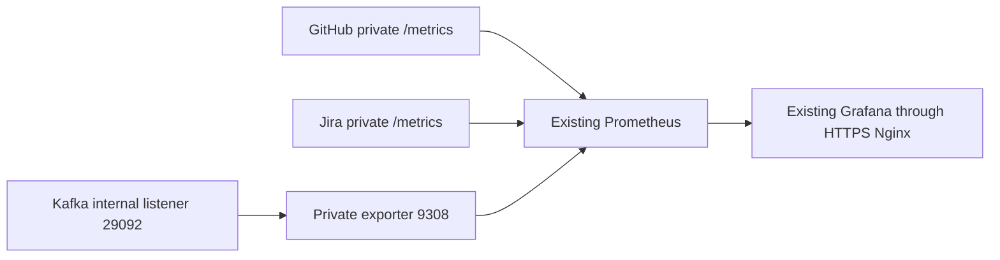

# Kafka observability and event processing

Status: locally implemented; production verification pending. No deployment was performed. The broker remains Apache Kafka 3.9.1; approved v1 topics, consumer groups, KRaft identity, retention, TLS configuration, certificates, database migrations and webhook contracts are unchanged.

## Architecture and gap analysis

The infrastructure VM already runs Kafka, MySQL, Nginx, Prometheus and Grafana on `researchtrack-infra`. Container Apps expose existing private `/metrics` endpoints. GitHub/Jira already export webhook, synchronization, reconciliation and durable business-job metrics. Existing availability, GitHub and Jira rules and dashboards remain intact.

The missing components were a broker exporter, shared Kafka worker metrics, cached outbox depth, Kafka dashboard, Kafka alerts, deterministic alert tests and monitoring-specific VM checks. The implementation adds these to that same platform:



`danielqsj/kafka-exporter:v1.10.0` is pinned to multi-architecture OCI digest `sha256:346a53c2489a3530790d01f7b96632496d0d58926662f4c35bb65f569db2ab42`. Version-specific flags were checked against [official v1.10.0 source](https://github.com/danielqsj/kafka_exporter/blob/v1.10.0/kafka_exporter.go), [documentation](https://github.com/danielqsj/kafka_exporter/blob/v1.10.0/README.md) and the official binary help. Actual broker compatibility still requires the disposable integration run and production verification.

The exporter uses `kafka:29092`, a pre-existing plaintext listener confined to the Docker network. The external private-IP SSL listener on 9092 is unchanged. The exporter has no host port, volume, CA key, keystore or Docker socket; it runs as nobody with a read-only filesystem, all capabilities dropped, no new privileges, 96 MiB and 0.1 CPU. Filters allow only the smoke/GitHub/Jira topics and two approved application groups. Auto topic creation is disabled. Production scrapes every 30 seconds with a 10-second timeout. Broker address/ID metadata is dropped at scrape time. Existing Prometheus/Grafana images, storage and datasource UID are preserved.

The shared Test configuration also defines the private `kafka-exporter:9308` job. The existing Test Compose stack has no Kafka broker/exporter: this job requires an independently supplied private test exporter/broker, and otherwise has UP=0/no broker data. Its constant `kafka_monitoring=optional` label suppresses exporter-down alerting for this intentionally unprovisioned Test target. Remove that label only after supplying the private test exporter/broker to require its availability. Production and isolated targets have no optional label; absent jobs still alert. This does not deploy Kafka into Test or imply Test has Kafka enabled. The isolated runner supplies both in its own disposable network.

## Metric semantics and privacy

| Family | Labels and meaning |
| --- | --- |
| `researchtrack_kafka_publish_total` | `service=github/jira`, `outcome=success/retryable_failure/permanent_failure`. Success follows broker acknowledgment **and** durable outbox bookkeeping; final exhaustion/fatal/contract failure is permanent. |
| `researchtrack_kafka_consume_total` | `service`, `stage=process/commit`, bounded `outcome`. Process `success` follows a new receipt transaction committing to the existing durable business pipeline; `duplicate` and `noop` are separate. Process `failed` counts failed attempts; `rejected` counts invalid contracts/deserialization. Commit `success/failed` is separate. |
| `researchtrack_kafka_retry_total` | `service`, `stage=publish/process`; increments when a retry actually starts. |
| `researchtrack_kafka_publish_duration_seconds` | Histogram, `service`; includes broker publish and outbox bookkeeping. |
| `researchtrack_kafka_processing_duration_seconds` | Histogram, `service`; validation and durable handoff, including bounded retries, excluding offset commit and downstream remote synchronization. |
| `researchtrack_kafka_enabled` | `service`; configured 0/1, including disabled services. Disabled mode does not register Kafka workers or clients and retains existing webhook handling. |
| `researchtrack_kafka_consumer_held` | `service`; 1 after the existing held-consumer policy. Resets on a reviewed service restart; no new automatic recovery policy. |
| `researchtrack_kafka_outbox_messages` | `service`, `status=pending/failed`; pending includes active PUBLISHING leases. |
| `researchtrack_kafka_outbox_sample_success` | `service`; last sampling operation succeeded, 0 on error. |
| `researchtrack_kafka_outbox_sample_timestamp_seconds` | `service`; time of last successful sample. |

The sampler runs once per minute with a five-second cancellation budget and one grouped, status-filtered database query. `/metrics` reads cached gauges, never the database. Failed samples retain the last depth but mark it invalid; dashboard/rules require success and age below 180 seconds. The oldest pending age is deliberately not queried. No migration is introduced.

Counters measure observed execution boundaries, not durable auditing. Crashes between a committed transaction and its metric increment can undercount; duplicate replay does not inflate durable handoff success. Broker acknowledgment followed by bookkeeping failure is a failed outbox publication iteration and may cause deduplicated replay. Downstream completion remains in `github_sync_runs_total`, GitHub webhook metrics, `jira_sync_runs_total` and Jira job metrics.

Application labels contain no event/correlation/repository/project/issue/user identifiers, payload, URLs, tokens or exception text. Existing Kafka logs retain their established correlation fields; new sampler logs expose only error type. Exporter labels are restricted to approved topic/group identities and partition numbers. Existing service authentication, metric endpoints and ingress routing are unchanged; the VM collects over private network paths, and port 9308 is never published. Do not add public gateway routes for service metrics.

## Broker health and lag limitations

Exporter `up=1` proves HTTP scraping only. `kafka_brokers` is cached metadata and may remain 1 during a broker outage. Recording rule `researchtrack_kafka_broker_healthy` requires all three: successful scrape, broker count at least 1, and a nonnegative current offset fetched from the existing `researchtrack.deployment-smoke` partition 0. Missing broker/offset metrics yield 0 when the target exists; a completely missing target yields no health sample and an exporter alert. A missing smoke topic also makes health unavailable: inspect/reconcile its approved registry separately, never auto-create it for metrics.

An exporter-down alert identifies a failed scrape, not a proven broker root cause. Broker connection failure can prevent exporter startup. A broker-unavailable alert with exporter UP identifies missing/invalid broker evidence. Neither should prompt storage recreation.

Measured lag is topic end offset minus committed group offset. Panels and alerts exclude unknown negative committed offsets. An absent group is no data, not zero; an inactive group with retained committed offsets has meaningful measured lag. Offsets can expire, groups can disappear and exporter refresh is delayed. Lag does not measure pending outbox rows or downstream synchronization jobs. This exporter is not JMX: JVM heap, broker CPU and throughput are not invented panels.

## Dashboard and alert thresholds

Open the existing `https://<GRAFANA_HOSTNAME>/`, sign in using the existing operator account, select **ResearchTrack → ResearchTrack — Kafka & Event Processing**. UID: `researchtrack-kafka-observability`; path: `/d/researchtrack-kafka-observability`. Provisioning uses the existing `prometheus` datasource. There are 18 operational panels in four sections and two additional overview panels. All ten original overview panels and both original service dashboards are preserved. Missing group/metric data stays no-data/unknown. Infrastructure and application alert tables use bounded alert labels.

All new alerts use `category=kafka` and bounded component/severity labels. Existing 15 alerts are unchanged.

| Alert suffix after `ResearchTrackKafka` | Condition | Stabilization / severity |
| --- | --- | --- |
| `ExporterUnavailable` | Required exporter target UP=0 or entire job missing; broker root cause unknown | 2m / critical |
| `BrokerUnavailable` | Health rule 0 while exporter UP=1 | 2m / critical |
| `PublishingFailures` | At least 3 retryable/permanent failed attempts in 10m | 2m / warning |
| `EventProcessingFailures` | At least 3 failed/rejected attempts in 10m | 2m / warning |
| `OffsetCommitFailures` | At least 3 commit failures in 10m | 2m / warning |
| `ConsumerHeld` | Held=1 | 1m / critical |
| `ConsumerLagHigh` | Measured approved group lag >100, known committed offsets | 10m / warning |
| `OutboxBacklog` | Fresh pending/PUBLISHING count >=100 | 5m / warning |
| `OutboxFailed` | Fresh failed count >0 | 2m / warning |
| `OutboxMetricsUnavailable` | Failed/absent sample or last success age >=180s | 5m / warning |

Application/group/outbox alerts require `researchtrack_kafka_enabled=1`. Broker monitoring remains active independently of application enablement. Isolated transient failure is distinguished from repeated failures and the separate held state. Error-count alerts resolve when failures age out of the 10m window; held resolves on reviewed application recovery, lag/backlog resolve after measured drain, sampler alert resolves after a fresh sample, infrastructure alerts resolve after evidence returns. Tune thresholds against measured production traffic only after review.

There is no new Alertmanager, email, Slack or paging configuration. These alerts are evaluated and visible in Prometheus/Grafana; no external notification route is verified.

## Repeatable tests and evidence

```bash
# Native Prometheus 3.15.0 promtool, or Docker fallback when PROMTOOL is absent:
PROMTOOL=/path/to/promtool ./scripts/test-kafka-observability.sh
python3 deploy/azure/validation/test_monitoring_reconciliation.py
python3 deploy/azure/validation/test_kafka_topics_config.py
./deploy/azure/validation/test-validate-azure-env-files.sh
./deploy/azure/validation/test-service-env-composition.sh
dotnet build ResearchTrack.sln -c Release --no-restore
dotnet test ResearchTrack.sln -c Release --no-build --filter 'Category!=DatabaseIntegration'
# Disposable TLS broker/MySQL/exporter/Prometheus; never real env files or Azure:
./scripts/test-kafka-integration.sh
```

Offline monitoring verification checks both Prometheus configs, all rules, 30 deterministic scenarios, every dashboard expression, datasource/UID/provisioning consistency, original overview/rule preservation and Compose exporter security. Mocked reconciliation tests execute the actual shell script, verify configuration validation precedes recreation, no broker/database/edge container mutations, unchanged container identities/start times and monitoring-only workflow behavior. Backend CI invokes these checks without changing triggers.

The isolated runner extends the pre-existing unique project and synthetic TLS/MySQL fixtures. Loopback ports are 19092, 13307 and Prometheus 19090; exporter/snapshot HTTP are Docker-private. Actual GitHub/Jira handler/worker registries are exported as bounded snapshots through a test-only HTTP server; this verifies Prometheus metric delivery but does not exercise a deployed ASP.NET `/metrics` endpoint. Existing business snapshot assertions remain. It exercises native producer timeout, three processing failures and actual held policy, 128 valid duplicate records behind the committed GitHub group offset, lag/held/failure alerts and receipt-safe recovery. Broker stop/start applies **only** to that disposable project. Fixture `for` durations are shortened to 10s; production expressions/thresholds remain identical and production durations are independently tested by promtool. Group interval remains 30s.

Missing Docker yields exit 2 and **NOT EXECUTED**, never PASS. Artifacts are under ignored `artifacts/kafka-integration/` (TRX, bounded metric snapshots and Prometheus target/alert state JSON); the existing manual integration workflow uploads them. Do not substitute fixture evidence for production evidence. Capture initial GH/Jira publication/processing assertions from TRX; final GH snapshot models restart and therefore has reset counters.

## Production delivery after review and separate authorization

1. Review the complete local diff, including the CA renderer correction, and run the isolated runner on a machine with Docker. Nothing in this task was committed, pushed or deployed. This branch's existing push triggers can deploy infrastructure/applications; plan the reviewed release before any push.
2. After approved code is available in the intended release ref, use the existing **Azure Infrastructure - Production** workflow's manual dispatch with **monitoring_only=true**, **allow_destructive=false**. It uses the existing production environment and concurrency protection. Do not select the default full reconciliation merely to add monitoring.
3. The workflow reads the last `researchtrack-prod-infrastructure` deployment outputs, requires an already-running VM, skips What-If/Bicep creation/VM setup/runtime secret materialization/network probes, and builds a monitoring-only bundle. No GitHub Environment secret changes are required.
4. Delivery uses existing managed Run Command support. The monitoring installer backs up Compose/Prometheus/Grafana configuration under `/opt/researchtrack/monitoring-backups/<timestamp>-<pid>`, syncs only monitoring configuration plus the Compose definition, and reuses existing runtime files. The script validates Compose and renders/checks Prometheus with the deployed Prometheus image before recreating monitoring containers. It pulls only the pinned exporter and uses the current Prometheus/Grafana image IDs; it does not upgrade their `latest` tags.
5. Only exporter, Prometheus and Grafana are reconciled with `--no-deps`; persistent monitoring data remains. Kafka/MySQL/Nginx container IDs and start times must match before and after. No Kafka TLS generation, topic provisioning, data formatting, migrations, application restart or image pruning occurs in this mode.
6. Deploy the reviewed GitHub/Jira images through their existing application release path when authorized, to expose the new application metrics. Monitoring-only delivery does not roll out application code. Preserve current `Kafka__Enabled` settings; production enablement still requires the approved contract and genuine public CA. No placeholder/SSH private key can substitute for it.
7. The workflow runs VM validation with `MONITORING_ONLY=true`: existing container/port/storage/TLS database checks remain, but the active Kafka TLS smoke producer is skipped. It checks exporter target, broker evidence, Prometheus rules/config and all four dashboard UIDs. Application verification is enabled only when all seven Container Apps exist.

## Production verification and evidence checklist

- Exporter running, exact pinned digest, no host binding/listener on 9308/29092/9093, no secret/key mounts; private SSL 9092 unchanged.
- Kafka/MySQL/Nginx IDs/start times unchanged; record Kafka identity/topic registry/TLS and persistent storage observations using existing read-only operational checks.
- Prometheus `/api/v1/targets` shows one UP `researchtrack-kafka` target with `service=kafka`, `environment=production`; `kafka_brokers=1`, smoke current offset >=0 and broker health=1. Missing evidence fails verification.
- `/api/v1/rules` includes `researchtrack-kafka`, the health recording rule and all ten new alerts plus existing groups/alerts. Run deployed `promtool check config`.
- Grafana `prometheus` datasource and all four dashboard UIDs available. Inspect existing panels, all 18 Kafka panels and the two overview additions; retain screenshots with timestamp/ref, not credentials.
- After application rollout, inspect existing private metrics from both services: configured enabled 0/1, bounded families, fresh sample only when enabled; valid ordinary traffic produces acknowledged publication, one durable handoff, distinct commit success, and downstream existing sync metrics. Approved duplicate traffic increments duplicate without another durable success. Disabled mode retains legacy webhooks.
- Query real lag only for existing groups with valid offsets; no groups must show no-data, not fabricated zero. Capture read-only queries/alert-state evidence and expected disabled gating.
- Validate alert transitions using deterministic promtool tests and disposable integration artifacts. Never stop, pause, corrupt or flood the production broker/consumers to demonstrate alerts. Observe natural recovery if a genuine incident occurs.
- Verify existing authentication/TLS, webhooks, reconciliation and database migration status with the established application runbook. Sanitize evidence; never attach env contents, payloads or private keys.

## Troubleshooting, recovery and rollback

Exporter UP=0: inspect container state, filtered logs, private DNS/listener and scrape target; broker connection failure can also prevent exporter startup. UP=1 with health=0: inspect broker count and the smoke partition offset before blaming exporter availability. Group missing/offset -1: confirm approved group has committed offsets, retention and exporter metadata refresh. Slow processing/held: use existing correlation-aware logs and receipt/outbox/job state under authorized access; repair root cause before reviewed service restart/replay. Never reset offsets to hide lag. Outbox sample invalid: check bounded sampler/database availability; cached depth is not trustworthy. A failure alert may remain during the rolling window after repair.

Rollback requires the usual production authorization and concurrency lock. Restore the recorded backup's validation script and Compose, Prometheus template/rules and Grafana provisioning **in place** (preserve directory inodes for bind mounts). Validate restored config with the currently deployed promtool, recreate only Prometheus/Grafana with `--no-deps --pull never` using current image IDs, and stop/remove only the exporter container if reverting its introduction. Do not run full stack `down`, remove volumes, restart Kafka/MySQL/Nginx, regenerate TLS, change topics or reset offsets. Grafana dashboard removal requires restoring provisioning consistent with existing deletion policy. Retain the backup until verification succeeds. Application instrumentation is additive and needs no DB rollback; an image rollback uses the existing release procedure and does not undo durable receipts/outbox rows or migrations. Record failures and restore monitoring config if preflight fails after bundle installation; it does not automatically roll back files.

## Exact Kafka dashboard PromQL

The expressions below are copied from provisioned JSON. `$environment` is the Grafana variable (`production` for direct Prometheus queries); no other interpolation is required. Dashboard metric names are validated against application definitions and the v1.10.0 exporter families.

**Kafka Broker Health**

```promql
researchtrack_kafka_broker_healthy{job="researchtrack-kafka", environment=~"$environment"}
```

**Broker Count**

```promql
kafka_brokers{job="researchtrack-kafka", environment=~"$environment"}
```

**Exporter Availability**

```promql
up{job="researchtrack-kafka", environment=~"$environment"}
```

**Kafka Topic Partitions**

```promql
kafka_topic_partitions{job="researchtrack-kafka", environment=~"$environment"}
```

**Kafka Consumer Group Members**

```promql
kafka_consumergroup_members{job="researchtrack-kafka", environment=~"$environment", consumergroup=~"researchtrack-(github|jira)-webhook-v1"}
```

**GitHub Event Publication Rate**

```promql
rate(researchtrack_kafka_publish_total{job="researchtrack-services", environment=~"$environment",service="github",outcome="success"}[5m])
```

**Jira Event Publication Rate**

```promql
rate(researchtrack_kafka_publish_total{job="researchtrack-services", environment=~"$environment",service="jira",outcome="success"}[5m])
```

**Kafka Publication Success vs Failure**

```promql
sum by (service,outcome) (rate(researchtrack_kafka_publish_total{job="researchtrack-services", environment=~"$environment"}[5m]))
```

**Kafka Consumer Processing Success vs Failure**

```promql
sum by (service,outcome) (rate(researchtrack_kafka_consume_total{job="researchtrack-services", environment=~"$environment",stage="process"}[5m]))
```

**Event Processing Duration · P95**

```promql
histogram_quantile(0.95, sum by (service,le) (rate(researchtrack_kafka_processing_duration_seconds_bucket{job="researchtrack-services", environment=~"$environment"}[5m])))
```

**Held Consumer Status**

```promql
researchtrack_kafka_consumer_held{job="researchtrack-services", environment=~"$environment"} and on(service,environment) researchtrack_kafka_enabled{job="researchtrack-services", environment=~"$environment"} == 1
```

**GitHub Consumer Lag**

```promql
sum by (consumergroup) (kafka_consumergroup_lag{job="researchtrack-kafka", environment=~"$environment",consumergroup="researchtrack-github-webhook-v1",topic="researchtrack.github.events.v1"} and on(job,instance,environment,consumergroup,topic,partition) kafka_consumergroup_current_offset{job="researchtrack-kafka", environment=~"$environment"} >= 0)
```

**Jira Consumer Lag**

```promql
sum by (consumergroup) (kafka_consumergroup_lag{job="researchtrack-kafka", environment=~"$environment",consumergroup="researchtrack-jira-webhook-v1",topic="researchtrack.jira.events.v1"} and on(job,instance,environment,consumergroup,topic,partition) kafka_consumergroup_current_offset{job="researchtrack-kafka", environment=~"$environment"} >= 0)
```

**Pending Kafka Outbox Messages**

```promql
researchtrack_kafka_outbox_messages{job="researchtrack-services", environment=~"$environment",status="pending"} and on(service,environment) researchtrack_kafka_outbox_sample_success{job="researchtrack-services", environment=~"$environment"} == 1 and on(service,environment) (time()-researchtrack_kafka_outbox_sample_timestamp_seconds{job="researchtrack-services", environment=~"$environment"}) < 180 and on(service,environment) researchtrack_kafka_enabled{job="researchtrack-services", environment=~"$environment"} == 1
```

**Permanently Failed Outbox Messages**

```promql
researchtrack_kafka_outbox_messages{job="researchtrack-services", environment=~"$environment",status="failed"} and on(service,environment) researchtrack_kafka_outbox_sample_success{job="researchtrack-services", environment=~"$environment"} == 1 and on(service,environment) (time()-researchtrack_kafka_outbox_sample_timestamp_seconds{job="researchtrack-services", environment=~"$environment"}) < 180 and on(service,environment) researchtrack_kafka_enabled{job="researchtrack-services", environment=~"$environment"} == 1
```

**Active Kafka Alerts**

```promql
ALERTS{category="kafka",alertstate="firing"}
```

**Broker Outage State**

```promql
ALERTS{alertname=~"ResearchTrackKafka(Broker|Exporter)Unavailable",alertstate="firing"}
```

**Event Processing Failure Alerts**

```promql
ALERTS{category="kafka",component=~"application|consumer|outbox",alertstate="firing"}
```
